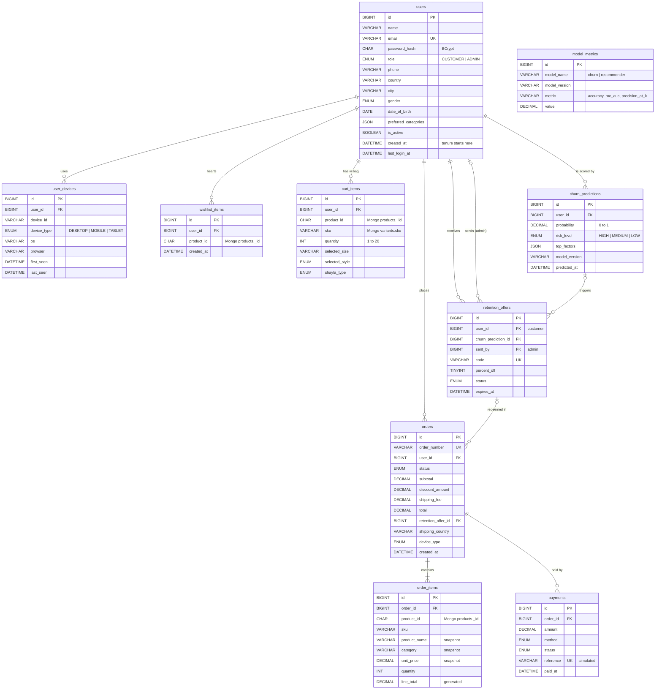
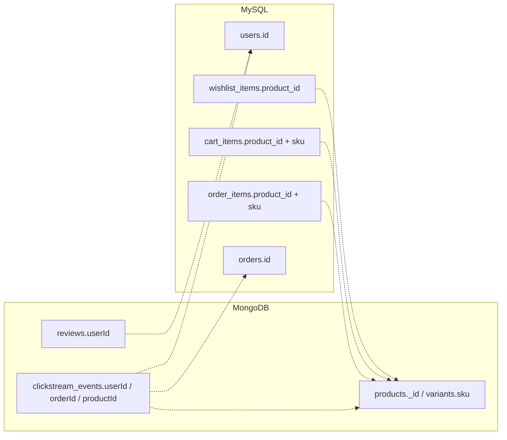

# Vela Noire: Entity-Relationship Diagram

Vela Noire stores its data in two databases, each chosen for what it does best:

| Database | Holds | Why |
|---|---|---|
| **MySQL** (`vela_noire`) | Users, devices, wishlist, cart, orders, order items, payments, churn predictions, retention offers, model metrics | Money and accounts need strict rules: fixed columns, foreign keys and transactions (ACID). |
| **MongoDB** (`vela_noire`) | Products (with variants), categories, collections, reviews, clickstream events | Products differ in shape (an abaya has sizes and lengths; a perfume has scent notes). Clickstream is a fast-growing log. A flexible document store fits both. |

## 1. MySQL tables

**What happens on delete:**
- Deleting a user removes their devices, wishlist, cart, predictions and offers (`CASCADE`).
- A user who has orders **cannot** be deleted (`RESTRICT`), so receipts are never lost.
- Deleting an order removes its items and payments (`CASCADE`).
- If an offer or prediction is deleted, the rows that pointed at it keep living with `NULL` (`SET NULL`).

## 2. MongoDB collections

| Collection | Main fields | Notes |
|---|---|---|
| `products` | `_id`, `name`, `slug`, `category`, `collection`, `season`, `seasonalLine`, `basePrice` (Decimal128), `tags[]`, **`variants[]`** (`sku`, colour, stock), `abaya{}` or `perfume{}`, `ratings{average,count}` | Variants are **embedded**: always read with the product. |
| `categories` | `slug`, `name`, `displayOrder` | abaya, perfume, handbag, bracelet, shayla, shoes, accessory |
| `collections` | `slug`, `name`, `tagline`, `palette[]`, `lines[]` | 4 collections: Seasonal (Desert Bloom, Velvet Moon, Amber Luxe, Floral Grace), Modern Muse, Traditions Reimagined, Simplicity Speaks |
| `reviews` | `productId`, `userId`, `rating` 1–5, `comment`, `verifiedPurchase` | **Referenced**, not embedded: reviews grow without limit. One per user per product. |
| `clickstream_events` | `userId`, `sessionId`, `type` (VIEW, SEARCH, ADD_TO_CART, …), `productId`, `device`, `timestamp` | The AI's training data (churn + recommender). |
| `brand_models` | `slug`, `name` | Empty for now. |

Each collection has a `$jsonSchema` validator (`database/mongodb/schemas/`) that rejects bad documents.

## 3. Links between the two databases

- MySQL stores a product's MongoDB `_id` as `CHAR(24)` (for example `6750a1000000000000000101`).
- MongoDB stores a MySQL `users.id` or `orders.id` as a number.
- **There is no foreign key across the two databases.** Each database only polices its own rows. The **Java backend** checks the links instead: before adding to the cart or placing an order, it confirms in MongoDB that the product and SKU exist and are in stock.
- `order_items` copies the product's name, category and price at purchase time (a **snapshot**). A receipt stays correct even if the product is later renamed, repriced or removed.
